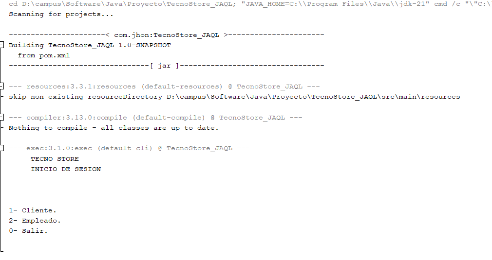
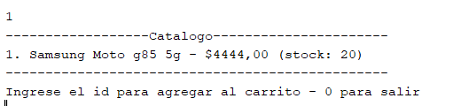
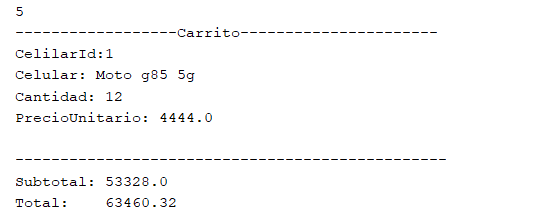
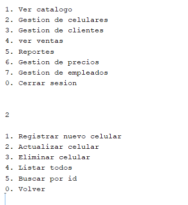
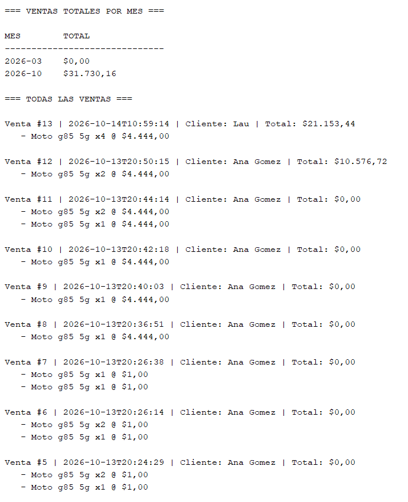

# 📱 TecnoStore --- Tienda virtual de celulares

[](https://openjdk.org/projects/jdk/21/)
[](https://maven.apache.org/)
[](https://www.mysql.com/)
[](./LICENSE)

**TecnoStore_JAQL** es una aplicación de consola desarrollada en Java
para gestionar una tienda virtual de celulares. Permite a los clientes
consultar el catálogo y realizar compras, mientras que los empleados
administran el inventario, los precios, los clientes y los reportes.

> Proyecto académico final del programa de formación **Campus Software
> Java**. Implementa Programación Orientada a Objetos, arquitectura
> MVC + DAO, JDBC, MySQL, principios SOLID, patrones de diseño y Stream
> API.

------------------------------------------------------------------------

## 📚 Tabla de contenidos

-   [Descripción del proyecto](#-descripción-del-proyecto)
-   [Características principales](#-características-principales)
    -   [Módulo de clientes](#módulo-de-clientes)
    -   [Módulo de empleados](#módulo-de-empleados)
-   [Tecnologías utilizadas](#-tecnologías-utilizadas)
-   [Arquitectura](#-arquitectura)
-   [Estructura del proyecto](#-estructura-del-proyecto)
-   [Modelo de base de datos](#-modelo-de-base-de-datos)
-   [Instalación y configuración](#-instalación-y-configuración)
-   [Uso de la aplicación](#-uso-de-la-aplicación)
-   [Ejemplo de ejecución](#-ejemplo-de-ejecución)
-   [Credenciales de prueba](#-credenciales-de-prueba)
-   [Capturas de pantalla](#-capturas-de-pantalla)
-   [Patrones de diseño aplicados](#-patrones-de-diseño-aplicados)
-   [Principios SOLID aplicados](#-principios-solid-aplicados)
-   [Reportes](#-reportes)
-   [Roadmap y mejoras futuras](#-roadmap-y-mejoras-futuras)
-   [Autor](#-autor)
-   [Licencia](#-licencia)
-   [Agradecimientos](#-agradecimientos)

------------------------------------------------------------------------

## 📝 Descripción del proyecto

TecnoStore es una tienda virtual de celulares operada desde una interfaz
de consola. Su objetivo es simular los procesos esenciales de un
comercio electrónico: registro y autenticación de usuarios, consulta de
productos, administración del carrito, confirmación de compras y gestión
del negocio.

La aplicación separa las responsabilidades en cuatro capas para
facilitar el mantenimiento, las pruebas y la evolución del código:

-   **Model:** entidades del dominio y reglas relacionadas con los
    datos.
-   **View:** menús, mensajes y entradas por consola.
-   **Control:** coordinación del flujo entre la vista, el modelo y la
    persistencia.
-   **Dao:** acceso a MySQL mediante JDBC.

El proyecto se desarrolló como trabajo final de **Campus Software Java**
para integrar conocimientos de Java, POO, consultas SQL, persistencia de
datos, diseño de software y generación de reportes.

### Objetivos del proyecto

-   Aplicar encapsulamiento, herencia, abstracción y polimorfismo.
-   Separar la presentación, la coordinación del flujo y el acceso a
    datos.
-   Gestionar información persistente en MySQL.
-   Controlar el inventario durante el proceso de venta.
-   Aplicar validaciones en la aplicación y en la base de datos.
-   Generar reportes útiles para el seguimiento de ventas e inventario.
-   Usar patrones de diseño y principios SOLID para favorecer un código
    mantenible.

------------------------------------------------------------------------

## ✨ Características principales

### Módulo de clientes

  -----------------------------------------------------------------------
  Funcionalidad                       Descripción
  ----------------------------------- -----------------------------------
  Registro                            Crear una cuenta con nombre,
                                      identificación, correo, teléfono y
                                      contraseña.

  Inicio de sesión                    Acceder con las credenciales
                                      registradas.

  Catálogo                            Consultar los celulares
                                      disponibles.

  Búsqueda                            Buscar productos por modelo.

  Filtro por marca                    Reducir el catálogo a una marca
                                      específica.

  Filtro por gama                     Consultar celulares de una gama
                                      determinada.

  Carrito                             Agregar productos y revisar los
                                      artículos seleccionados.

  Resumen de compra                   Consultar subtotal, IVA y total
                                      antes de confirmar.

  Compra                              Confirmar una compra y registrar la
                                      venta.

  Historial                           Consultar compras anteriores.

  Perfil                              Revisar la información de la
                                      cuenta.

  Cambio de contraseña                Actualizar la contraseña desde la
                                      sesión del usuario.
  -----------------------------------------------------------------------

### Módulo de empleados

Las opciones disponibles pueden variar según el cargo y los permisos
configurados para cada empleado.

  -----------------------------------------------------------------------
  Funcionalidad                       Descripción
  ----------------------------------- -----------------------------------
  Autenticación                       Acceso al sistema con una cuenta de
                                      empleado.

  Gestión de celulares                Crear, consultar, actualizar y
                                      eliminar celulares.

  Gestión de precios                  Administrar los precios definidos
                                      para los productos.

  Gestión de clientes                 Consultar y administrar los
                                      registros de clientes.

  Consulta de ventas                  Revisar las ventas registradas.

  Reporte de stock bajo               Identificar celulares que requieren
                                      reposición.

  Top de celulares                    Consultar los tres celulares más
                                      vendidos.

  Ventas por mes                      Revisar los totales agrupados por
                                      mes.

  Reporte general                     Consultar métricas y el detalle de
                                      las ventas.

  Exportación                         Generar el archivo
                                      `reporte_ventas.txt`.
  -----------------------------------------------------------------------

### Roles contemplados

-   **Admin:** administración general del sistema, de acuerdo con los
    permisos implementados.
-   **Bodega:** tareas relacionadas con productos e inventario, según la
    configuración del proyecto.
-   **Gerente:** consulta y seguimiento de información del negocio,
    según la configuración del proyecto.
-   **Vendedor:** aparece en las credenciales de prueba. Las opciones
    efectivas dependen de los roles implementados en el código.

> **Nota:** las acciones concretas permitidas a cada rol deben
> verificarse en los controladores y las vistas del repositorio. La
> lista anterior describe los perfiles previstos, no una matriz de
> permisos exhaustiva.

------------------------------------------------------------------------

## 🧰 Tecnologías utilizadas

  -----------------------------------------------------------------------
  Tecnología              Versión                 Uso
  ----------------------- ----------------------- -----------------------
  Java                    21                      Lenguaje principal de
                                                  la aplicación.

  Maven                   Según `pom.xml`         Gestión de dependencias
                                                  y ciclo de compilación.

  NetBeans                25                      Entorno de desarrollo
                                                  utilizado.

  MySQL                   8.0                     Base de datos
                                                  relacional.

  JDBC                    API incluida en Java    Conexión y ejecución de
                                                  operaciones SQL desde
                                                  Java.

  MySQL Connector/J       Según `pom.xml`         Driver JDBC para
                                                  conectarse a MySQL.

  Stream API              Java 21                 Filtrado,
                                                  transformación,
                                                  agrupación y cálculo de
                                                  datos para reportes.

  Git                     Según instalación local Control de versiones.

  GitHub                  Plataforma              Alojamiento del código
                                                  y documentación.
  -----------------------------------------------------------------------

------------------------------------------------------------------------

## 🏗️ Arquitectura

TecnoStore utiliza una arquitectura **MVC + DAO**, organizada en cuatro
capas lógicas. MVC distribuye las responsabilidades de presentación y
coordinación, mientras DAO encapsula el acceso a datos.

### Diagrama de arquitectura

``` text
┌───────────────────────────────────────────────┐
│                    Usuario                    │
└───────────────────────┬───────────────────────┘
                        │ Entrada / salida
                        ▼
┌───────────────────────────────────────────────┐
│                   VIEW                        │
│ Menús, mensajes, lectura y validación consola  │
│ VistaLogin, VistaTienda, VistaVentas, etc.     │
└───────────────────────┬───────────────────────┘
                        │ Solicitudes
                        ▼
┌───────────────────────────────────────────────┐
│                  CONTROL                      │
│ Coordina casos de uso y reglas de flujo        │
│ LoginControl, TiendaControl, CarritoControl... │
└───────────────────────┬───────────────────────┘
                        │ Usa / coordina
                        ▼
┌───────────────────────────────────────────────┐
│                   MODEL                       │
│ Entidades y conceptos del dominio              │
│ Celular, Cliente, Empleado, Venta, Carrito...  │
└───────────────────────┬───────────────────────┘
                        │ Persistencia solicitada
                        ▼
┌───────────────────────────────────────────────┐
│                    DAO                         │
│ Consultas SQL y operaciones mediante JDBC      │
│ CelularDao, ClienteDao, VentaDao, etc.         │
└───────────────────────┬───────────────────────┘
                        │ JDBC
                        ▼
┌───────────────────────────────────────────────┐
│                  MySQL 8.0                    │
│ Tablas, procedimientos, funciones, triggers    │
│ y vistas                                       │
└───────────────────────────────────────────────┘
```

### Responsabilidades por capa

  -----------------------------------------------------------------------
  Capa                    Responsabilidad         Ejemplos
  ----------------------- ----------------------- -----------------------
  `View`                  Presentar opciones,     `VistaLogin`,
                          solicitar datos y       `VistaTienda`,
                          mostrar resultados.     `VistaReportes`

  `Control`               Coordinar las acciones  `LoginControl`,
                          del usuario y los       `CarritoControl`,
                          componentes de la       `EmpresaControl`
                          aplicación.             

  `Model`                 Representar las         `Celular`, `Cliente`,
                          entidades y conceptos   `Empleado`, `Venta`
                          del negocio.            

  `Dao`                   Encapsular las          `CelularDao`,
                          consultas SQL y la      `ClienteDao`,
                          persistencia con JDBC.  `VentaDao`
  -----------------------------------------------------------------------

### Flujo típico de una operación

1.  El usuario selecciona una opción en una vista.
2.  La vista recoge y valida la entrada.
3.  El controlador coordina la operación.
4.  El DAO consulta o modifica la base de datos cuando corresponde.
5.  MySQL ejecuta la operación y aplica las restricciones configuradas.
6.  El resultado vuelve al controlador y se presenta en la vista.

------------------------------------------------------------------------

## 📁 Estructura del proyecto

El siguiente árbol representa la organización lógica conocida del
proyecto. Algunos nombres pueden variar según los archivos presentes en
el repositorio.

``` text
TecnoStore_JAQL/
├── pom.xml
├── README.md
├── LICENSE
├── sql/
│   ├── tecnostore_db.sql
│   ├── procedimientos_almacenados.sql
│   ├── funciones.sql
│   ├── triggers.sql
│   └── vistas.sql
├── reporte_ventas.txt
└── src/
    ├── main/
    │   ├── java/
    │   │   └── com/
    │   │       └── jhon/
    │   │           └── proyecto_jaql/
    │   │               ├── Main.java
    │   │               ├── Control/
    │   │               │   ├── LoginControl.java
    │   │               │   ├── TiendaControl.java
    │   │               │   ├── CarritoControl.java
    │   │               │   ├── EmpresaControl.java
    │   │               │   └── CelularesControl.java
    │   │               ├── Dao/
    │   │               │   ├── DB_SQL.java
    │   │               │   ├── CelularDao.java
    │   │               │   ├── ClienteDao.java
    │   │               │   ├── EmpleadoDao.java
    │   │               │   ├── VentaDao.java
    │   │               │   ├── MarcaDao.java
    │   │               │   ├── PreciosDao.java
    │   │               │   └── SistemasOperativosDao.java
    │   │               ├── Model/
    │   │               │   ├── Celular.java
    │   │               │   ├── Cliente.java
    │   │               │   ├── Empleado.java
    │   │               │   ├── Venta.java
    │   │               │   ├── CelularVenta.java
    │   │               │   ├── Carrito.java
    │   │               │   ├── Precio.java
    │   │               │   ├── Marca.java
    │   │               │   ├── SistemaOperativo.java
    │   │               │   └── CategoriaGama.java
    │   │               └── View/
    │   │                   ├── VistaLogin.java
    │   │                   ├── VistaTienda.java
    │   │                   ├── VistaVentas.java
    │   │                   ├── VistaClientes.java
    │   │                   ├── VistaCelulares.java
    │   │                   ├── VistaReportes.java
    │   │                   ├── VistaAdmin.java
    │   │                   └── validaciones/
    │   │                       ├── Texto.java
    │   │                       ├── Entero.java
    │   │                       ├── Decimal.java
    │   │                       └── Entrada.java
    │   └── resources/
    └── test/
        └── java/
```

> **Importante:** el árbol es una guía documental basada en la
> estructura descrita. Conserva los nombres y las rutas que realmente
> existan en tu repositorio. Los archivos SQL mostrados son nombres
> sugeridos; si tu proyecto usa un único script o nombres diferentes,
> actualiza esta sección.

------------------------------------------------------------------------

## 🗄️ Modelo de base de datos

**Base de datos:** `TecnoStore_JAQO`\
**Motor:** MySQL 8.0

### Tablas principales

  -----------------------------------------------------------------------
  Tabla                   Propósito               Campos destacados
  ----------------------- ----------------------- -----------------------
  `personas`              Información general     `id`, `nombre`,
                          compartida por clientes `identificacion`,
                          y empleados.            `correo`, `telefono`,
                                                  `tipo`

  `clientes`              Datos específicos de    `persona_id`,
                          los clientes.           `fecha_registro`

  `empleados`             Datos laborales de los  `persona_id`, `cargo`,
                          empleados.              `salario`,
                                                  `fecha_ingreso`,
                                                  `activo`

  `usuarios`              Credenciales, rol y     `persona_id`, `correo`,
                          estado de acceso.       `contrasena`, `rol`,
                                                  `activo`

  `marcas`                Catálogo de marcas de   `id`, `nombre`
                          celulares.              

  `sistemas_operativos`   Sistemas operativos     `id`, `nombre`
                          disponibles.            

  `gamas`                 Categorías o gamas de   `id`, `nombre`
                          celulares.              

  `precios`               Valores de precio       `id`, `nombre`, `monto`
                          gestionados por el      
                          sistema.                

  `celulares`             Inventario de           `id`, `marca_id`,
                          celulares.              `modelo`, `precio_id`,
                                                  `so_id`, `gama_id`,
                                                  `stock`, `stock_minimo`

  `ventas`                Cabecera de cada venta. `id`, `cliente_id`,
                                                  `fecha`, `total`

  `detalle_ventas`        Productos y cantidades  `id`, `venta_id`,
                          incluidos en cada       `celular_id`,
                          venta.                  `cantidad`,
                                                  `precio_unitario`

  `auditoria_celulares`   Historial de cambios    `id`, `celular_id`,
                          auditados en celulares. `campo`, `valor_antes`,
                                                  `valor_despues`,
                                                  `usuario_bd`, `fecha`
  -----------------------------------------------------------------------

### Relaciones conceptuales

``` text
personas ────────┬──────── clientes ───────── ventas
                 │                              │
                 ├──────── empleados            │
                 │                              ▼
                 └──────── usuarios       detalle_ventas
                                                │
                                                ▼
                                            celulares
                                          /    |    \
                                     marcas  precios  gamas
                                                |
                                      sistemas_operativos
```

Las relaciones físicas exactas dependen de las claves foráneas definidas
en los scripts SQL. En particular, `detalle_ventas` relaciona las ventas
con los celulares vendidos y conserva `precio_unitario` para representar
el precio histórico aplicado en el momento de la compra.

### Procedimientos almacenados

  -----------------------------------------------------------------------------------------------------------
  Procedimiento                                                           Propósito
  ----------------------------------------------------------------------- -----------------------------------
  `sp_registrar_venta(cliente_id, items_json, OUT venta_id, OUT total)`   Registra una venta y devuelve su
                                                                          identificador y total.

  `sp_crear_cliente`                                                      Registra un cliente.

  `sp_actualizar_cliente`                                                 Actualiza información de un
                                                                          cliente.

  `sp_eliminar_cliente`                                                   Elimina o gestiona la eliminación
                                                                          de un cliente según las reglas
                                                                          implementadas.

  `sp_crear_empleado`                                                     Registra un empleado.

  `sp_actualizar_empleado`                                                Actualiza los datos de un empleado.

  `sp_eliminar_empleado`                                                  Elimina o gestiona la eliminación
                                                                          de un empleado.

  `sp_crear_celular`                                                      Registra un celular en el
                                                                          inventario.

  `sp_actualizar_celular`                                                 Actualiza la información de un
                                                                          celular.

  `sp_eliminar_celular`                                                   Elimina o gestiona la eliminación
                                                                          de un celular.

  `sp_autenticar`                                                         Gestiona la autenticación.

  `sp_cambiar_password`                                                   Cambia la contraseña de un usuario.

  `sp_anular_venta`                                                       Gestiona la anulación de una venta.
  -----------------------------------------------------------------------------------------------------------

Los parámetros exactos, sus tipos y el comportamiento de cada
procedimiento deben consultarse en el script SQL correspondiente.

### Triggers

  -----------------------------------------------------------------------
  Trigger                             Responsabilidad descrita
  ----------------------------------- -----------------------------------
  `trg_detalle_after_insert`          Descuenta unidades del inventario
                                      al insertar un detalle de venta.

  `trg_detalle_after_delete`          Devuelve unidades al inventario al
                                      eliminar un detalle.

  `trg_detalle_after_update`          Ajusta el inventario cuando cambia
                                      la cantidad vendida.

  `trg_detalle_before_update`         Protege el precio histórico y el
                                      celular asociado al detalle.

  `trg_celular_before_insert`         Valida datos del celular antes de
                                      insertarlo.

  `trg_celular_before_update`         Valida datos del celular antes de
                                      actualizarlo.

  `trg_persona_before_insert`         Valida datos de una persona antes
                                      de insertarla.

  `trg_persona_before_update`         Valida datos de una persona antes
                                      de actualizarla.

  `trg_usuario_before_insert`         Valida la compatibilidad entre el
                                      rol y el tipo de persona.
  -----------------------------------------------------------------------

### Funciones SQL

  -----------------------------------------------------------------------
  Función                             Propósito
  ----------------------------------- -----------------------------------
  `fn_hash_password`                  Genera un hash de contraseña usando
                                      el mecanismo descrito como
                                      SHA-256 + salt.

  `fn_identificacion_valida`          Valida el formato o las reglas
                                      definidas para una identificación.

  `fn_correo_valido`                  Comprueba el formato del correo
                                      según las reglas SQL implementadas.

  `fn_total_venta`                    Calcula o consulta el total de una
                                      venta.

  `fn_hay_stock`                      Comprueba la disponibilidad de
                                      inventario.
  -----------------------------------------------------------------------

> **Seguridad:** para un sistema real, es preferible almacenar
> contraseñas con un algoritmo específico para contraseñas, como
> Argon2id, bcrypt o PBKDF2, con sal única y parámetros de coste
> adecuados. SHA-256 por sí solo no es un algoritmo recomendado para
> almacenar contraseñas. Revisa también que las credenciales de prueba
> no se utilicen en producción.

### Vistas SQL

  -----------------------------------------------------------------------
  Vista                               Información
  ----------------------------------- -----------------------------------
  `v_ventas_totales`                  Información agregada de ventas.

  `v_top_celulares`                   Celulares destacados por ventas.

  `v_ventas_por_mes`                  Totales agrupados por mes.

  `v_stock_bajo`                      Celulares cuyo inventario requiere
                                      atención.

  `v_usuarios_detalle`                Información consolidada de usuarios
                                      para consultas administrativas.
  -----------------------------------------------------------------------

------------------------------------------------------------------------

## ⚙️ Instalación y configuración

Sigue estos pasos para preparar el entorno local.

### 1. Requisitos previos

Instala y configura:

-   **JDK 21** o una distribución compatible con Java 21.
-   **Apache Maven**, si no utilizarás el Maven integrado en el IDE.
-   **MySQL Server 8.0**.
-   **MySQL Workbench** u otro cliente SQL (opcional, pero útil).
-   **Git**.
-   **NetBeans 25** o un IDE compatible con proyectos Maven.

Verifica las instalaciones desde una terminal:

``` bash
java -version
mvn -version
git --version
```

La versión de Java reportada debe corresponder a Java 21. Comprueba
también que Maven utilice el JDK correcto.

### 2. Clonar el repositorio

Reemplaza la URL de ejemplo por la URL real del repositorio de
TecnoStore:

``` bash
git clone https://github.com/USUARIO/REPOSITORIO.git
cd TecnoStore_JAQL
```

Si el repositorio tiene otro nombre, entra en el directorio que Git haya
creado.

### 3. Crear la base de datos

Inicia sesión en MySQL con un usuario que tenga permisos para crear la
base de datos y ejecuta:

``` sql
CREATE DATABASE TecnoStore_JAQO
    CHARACTER SET utf8mb4
    COLLATE utf8mb4_unicode_ci;
```

Selecciona la base de datos:

``` sql
USE TecnoStore_JAQO;
```

Después, ejecuta los scripts SQL que existan realmente en el
repositorio. Por ejemplo, si se encuentran organizados por archivos:

``` bash
mysql -u TU_USUARIO -p TecnoStore_JAQO < ./sql/tecnostore_db.sql
mysql -u TU_USUARIO -p TecnoStore_JAQO < ./sql/funciones.sql
mysql -u TU_USUARIO -p TecnoStore_JAQO < ./sql/procedimientos_almacenados.sql
mysql -u TU_USUARIO -p TecnoStore_JAQO < ./sql/triggers.sql
mysql -u TU_USUARIO -p TecnoStore_JAQO < ./sql/vistas.sql
```

Estos nombres son ejemplos de organización. **Ajusta los comandos al
nombre, orden y contenido de los scripts disponibles.** Si todas las
tablas, funciones, procedimientos, triggers y vistas están en un único
archivo, ejecuta únicamente ese archivo.

Comprueba que las tablas se hayan creado:

``` sql
USE TecnoStore_JAQO;
SHOW TABLES;
```

Si el proyecto incluye datos de prueba, importa el script de datos
después de crear la estructura y los objetos SQL requeridos.

### 4. Configurar la conexión a MySQL

Localiza `DB_SQL.java` dentro del paquete `Dao`. Ajusta el host, puerto,
nombre de base de datos y credenciales de conexión según tu entorno.

Ejemplo ilustrativo de configuración JDBC:

``` java
String url = "jdbc:mysql://localhost:3306/TecnoStore_JAQO";
String usuario = System.getenv("TECNO_DB_USER");
String password = System.getenv("TECNO_DB_PASSWORD");
```

La forma exacta de configurar la conexión depende de la implementación
actual de `DB_SQL.java`. Si el código utiliza variables de entorno,
configúralas antes de ejecutar la aplicación.

**Windows PowerShell:**

``` powershell
$env:TECNO_DB_USER = "tu_usuario"
$env:TECNO_DB_PASSWORD = "tu_contrasena"
```

**Linux / macOS:**

``` bash
export TECNO_DB_USER="tu_usuario"
export TECNO_DB_PASSWORD="tu_contrasena"
```

No subas contraseñas reales al repositorio. Para un proyecto público,
utiliza variables de entorno o un archivo local excluido mediante
`.gitignore`. Evita usar el usuario `root` como cuenta de conexión de la
aplicación; crea un usuario MySQL con los permisos mínimos necesarios.

### 5. Compilar el proyecto

Desde la raíz que contiene `pom.xml`, ejecuta:

``` bash
mvn clean compile
```

Para ejecutar las pruebas automatizadas, si existen:

``` bash
mvn test
```

Para generar el artefacto:

``` bash
mvn clean package
```

El JAR se genera normalmente en `target/`. Su nombre exacto depende de
la configuración de Maven.

### 6. Ejecutar la aplicación

Desde NetBeans:

1.  Abre el proyecto mediante **File \> Open Project**.
2.  Selecciona la carpeta que contiene `pom.xml`.
3.  Espera a que Maven resuelva las dependencias.
4.  Comprueba la configuración de conexión a MySQL.
5.  Ejecuta `Main.java` o utiliza la opción **Run Project**.

Desde la terminal, si Maven tiene configurada la clase principal y el
empaquetado correspondiente:

``` bash
mvn exec:java
```

Este comando requiere que el plugin `exec-maven-plugin` esté configurado
en `pom.xml`. Si no lo está, ejecuta la clase principal desde NetBeans o
configura el plugin antes de usar el comando.

### 7. Verificaciones iniciales

Antes de probar una compra, comprueba:

-   [ ] MySQL está activo y acepta conexiones.
-   [ ] La base `TecnoStore_JAQO` existe.
-   [ ] Las tablas y objetos SQL requeridos fueron creados.
-   [ ] Los datos iniciales están cargados, si son necesarios.
-   [ ] `DB_SQL.java` apunta a la base correcta.
-   [ ] El driver MySQL Connector/J está declarado en `pom.xml`.
-   [ ] La aplicación puede iniciar sesión sin errores de conexión.

------------------------------------------------------------------------

## ▶️ Uso de la aplicación

Al iniciar el programa, la aplicación presenta la interfaz de consola
definida en `Main.java` y en las vistas. Las opciones exactas dependen
de la implementación actual.

### Menú del cliente

Flujo de uso habitual:

1.  Seleccionar la opción de registro si todavía no existe una cuenta.
2.  Iniciar sesión con correo y contraseña.
3.  Consultar el catálogo de celulares.
4.  Buscar por modelo o aplicar filtros de marca y gama.
5.  Agregar uno o varios celulares al carrito.
6.  Revisar el subtotal, el IVA y el total.
7.  Confirmar la compra.
8.  Consultar el historial de compras o el perfil.

Ejemplo ilustrativo de interacción:

``` text
========================================
              TECNOSTORE
========================================
1. Iniciar sesión
2. Registrarse
0. Salir
Seleccione una opción: 1

Correo: cliente@tecnostore.com
Contraseña: ********

Inicio de sesión exitoso.
Bienvenido/a a TecnoStore.

1. Ver catálogo
2. Buscar celular
3. Filtrar por marca
4. Filtrar por gama
5. Ver carrito
6. Historial de compras
7. Mi perfil
8. Cambiar contraseña
0. Cerrar sesión
Seleccione una opción:
```

Los textos y números del menú son una **representación de referencia**,
no una captura literal de la salida del programa. Sustitúyelos por el
output real de la aplicación si los menús tienen otras opciones.

### Menú del empleado

Flujo de uso habitual:

1.  Iniciar sesión con una cuenta de empleado.
2.  Abrir las opciones habilitadas para el cargo.
3.  Administrar celulares, precios o clientes según los permisos.
4.  Consultar las ventas.
5.  Abrir la sección de reportes.
6.  Generar `reporte_ventas.txt` cuando se requiera.

Ejemplo ilustrativo:

``` text
========================================
          TECNOSTORE - EMPLEADOS
========================================
Correo: empleado@tecnostore.com
Contraseña: ********

Acceso concedido.

1. Administrar celulares
2. Administrar precios
3. Administrar clientes
4. Consultar ventas
5. Ver reportes
6. Generar reporte de ventas
0. Cerrar sesión
Seleccione una opción:
```

La aplicación puede mostrar un menú distinto según el cargo. Verifica en
las vistas y controladores cuáles opciones están habilitadas para cada
perfil.

------------------------------------------------------------------------

## 💻 Ejemplo de ejecución

El siguiente ejemplo muestra el tipo de salida que podría verse durante
una consulta de catálogo y una compra. **Es un ejemplo ilustrativo de
documentación, no una transcripción verificada de una ejecución real.**
Actualiza los nombres, valores y mensajes con una salida capturada de tu
aplicación.

``` text
----------------------------------------
             CATÁLOGO TECNOSTORE
----------------------------------------
ID: 1
Marca: Samsung
Modelo: Galaxy A55
Gama: Media
Precio: $1.499.900
Stock disponible: 8

ID: 2
Marca: Motorola
Modelo: Edge 50
Gama: Alta
Precio: $1.899.900
Stock disponible: 5

Seleccione el ID del celular para agregar al carrito: 1
Ingrese la cantidad: 1

Producto agregado al carrito.

----------------------------------------
                 CARRITO
----------------------------------------
Producto: Samsung Galaxy A55
Cantidad: 1
Subtotal: $1.499.900
IVA: $284.981
Total: $1.784.881

¿Desea confirmar la compra? (S/N): S

Procesando compra...
Venta registrada correctamente.
Número de venta: 104
Total pagado: $1.784.881

Gracias por comprar en TecnoStore.
```

Los precios, el porcentaje de IVA, el número de venta y la
disponibilidad son datos ficticios de ejemplo. El valor real depende de
los datos de la base de datos y de las reglas configuradas en el
proyecto.

------------------------------------------------------------------------

## 🔐 Credenciales de prueba

Las siguientes credenciales fueron definidas para pruebas del proyecto.
Solo funcionarán si los usuarios correspondientes existen en la base de
datos cargada.

  Perfil          Correo                         Contraseña       Cargo indicado
  --------------- ------------------------------ ---------------- ----------------
  Cliente         `lauu@tecnostore.com`          `Incorrecta1.`   Cliente
  Empleado        `pedro.lopez@tecnostore.com`   `vendedor123`    Vendedor
  Administrador   `sofia.mora@tecnostore.com`    `admin123`       Admin

> **Precaución:** la contraseña del cliente se conserva tal como fue
> proporcionada, aunque su valor parece estar marcado como incorrecto.
> Si no permite iniciar sesión, verifica el script de datos de prueba o
> registra un cliente nuevo. Cambia o elimina estas credenciales antes
> de cualquier despliegue real y no reutilices contraseñas de prueba.

------------------------------------------------------------------------

## 📸 Capturas de pantalla

Agrega las capturas en una carpeta como `docs/screenshots/` y actualiza
las rutas según los archivos existentes. Estas imágenes permiten que un
reclutador o compañero entienda la aplicación sin ejecutarla.

### Inicio de sesión



### Catálogo de celulares



### Carrito de compras



### Administración de celulares


()

### Reportes


> Las imágenes anteriores son placeholders. Crea los archivos
> correspondientes o reemplaza las rutas por las capturas reales para
> evitar enlaces rotos en GitHub.

------------------------------------------------------------------------

## 🧩 Patrones de diseño aplicados

  -----------------------------------------------------------------------
  Patrón                  Clase o componente      Propósito
                          asociado                
  ----------------------- ----------------------- -----------------------
  Singleton               `DB_SQL`                Centralizar el acceso a
                                                  la instancia o
                                                  configuración de
                                                  conexión a la base de
                                                  datos, según la
                                                  implementación.

  DAO (Data Access        `CelularDao`,           Aislar el acceso a
  Object)                 `ClienteDao`,           datos y las consultas
                          `VentaDao`, entre otros SQL de la lógica de
                                                  presentación.

  Builder                 Entidades como          Facilitar la
                          `Celular`, `Cliente` y  construcción de objetos
                          `Empleado`              con varios atributos y
                                                  mejorar la legibilidad
                                                  de su creación.

  Factory                 Componente o método de  Encapsular la lógica de
                          creación de entidades   creación y centralizar
                                                  la selección del tipo
                                                  de objeto que debe
                                                  construirse.
  -----------------------------------------------------------------------

### Beneficios

-   Reduce el acoplamiento entre los componentes.
-   Hace más claro dónde se construyen los objetos y dónde se consulta
    la base de datos.
-   Facilita el mantenimiento y la ampliación de funcionalidades.
-   Permite probar responsabilidades de forma más aislada.

> La clase o método exacto que implementa Factory depende de la
> estructura concreta del código. En la documentación final conviene
> enlazar el archivo real donde se encuentre ese patrón.

------------------------------------------------------------------------

## 🧱 Principios SOLID aplicados

  -----------------------------------------------------------------------
  Principio               Dónde se aplica         Cómo contribuye
  ----------------------- ----------------------- -----------------------
  **S --- Single          Vistas, controladores,  Cada componente se
  Responsibility          modelos y DAO           concentra en una
  Principle**                                     responsabilidad
                                                  principal:
                                                  presentación,
                                                  coordinación, dominio o
                                                  persistencia.

  **O --- Open/Closed     Entidades y componentes Busca permitir nuevas
  Principle**             extensibles             variantes o
                                                  comportamientos sin
                                                  modificar
                                                  innecesariamente código
                                                  estable.

  **L --- Liskov          Jerarquía `Persona` →   Las clases derivadas
  Substitution            `Cliente` / `Empleado`  deben poder utilizarse
  Principle**                                     donde se espera una
                                                  `Persona` sin romper el
                                                  comportamiento
                                                  esperado.

  **I --- Interface       Interfaces de acceso a  Las clases deberían
  Segregation Principle** datos, cuando están     depender de contratos
                          definidas               específicos y no de
                                                  interfaces con métodos
                                                  que no necesitan.

  **D --- Dependency      Controladores y DAOs,   Reduce el acoplamiento
  Inversion Principle**   especialmente si se     al depender de
                          inyectan abstracciones  contratos en lugar de
                                                  implementaciones
                                                  concretas.
  -----------------------------------------------------------------------

### Aplicación práctica

-   Mantener las consultas SQL en la capa `Dao`.
-   Evitar que las vistas ejecuten directamente operaciones de
    persistencia.
-   Centralizar en los controladores la coordinación de los casos de
    uso.
-   Mantener las entidades enfocadas en los conceptos del dominio.
-   Favorecer interfaces específicas para desacoplar la lógica de
    negocio de la persistencia.
-   Evitar que la herencia entre `Persona`, `Cliente` y `Empleado`
    genere comportamientos incompatibles.

SOLID es una guía de diseño: la aplicación efectiva de cada principio
debe verificarse en el código y en las dependencias reales del proyecto.

------------------------------------------------------------------------

## 📊 Reportes

TecnoStore puede generar el archivo `reporte_ventas.txt` con información
agregada y detalle operativo para apoyar el seguimiento del negocio.

### Contenido del reporte

  -----------------------------------------------------------------------
  Sección                             Información
  ----------------------------------- -----------------------------------
  Resumen general                     Número de ventas, total facturado,
                                      ticket promedio y unidades
                                      vendidas.

  Top 3 de celulares                  Los tres celulares más vendidos.

  Ventas por mes                      Totales de ventas agrupados por
                                      mes.

  Stock bajo                          Celulares que alcanzaron el umbral
                                      mínimo de inventario.

  Detalle de ventas                   Información de todas las ventas
                                      registradas.
  -----------------------------------------------------------------------

### Stream API

Los reportes utilizan operaciones de la Stream API de Java para procesar
colecciones. Entre las operaciones previstas están:

  -----------------------------------------------------------------------
  Operación                           Uso habitual
  ----------------------------------- -----------------------------------
  `filter`                            Seleccionar ventas o productos que
                                      cumplan una condición.

  `map`                               Transformar objetos en valores
                                      necesarios para el reporte.

  `Collectors.groupingBy`             Agrupar registros por mes, producto
                                      u otra categoría.

  `sum` / `mapToDouble`               Calcular totales numéricos.

  `sorted`                            Ordenar resultados, por ejemplo,
                                      por unidades vendidas.

  `limit`                             Obtener solo los primeros tres
                                      elementos del ranking.
  -----------------------------------------------------------------------

Ejemplo conceptual de agrupación de ventas por mes:

``` java
Map<String, List<Venta>> ventasPorMes = ventas.stream()
    .collect(Collectors.groupingBy(venta ->
        venta.getFecha().getYear() + "-"
        + venta.getFecha().getMonthValue()
    ));
```

Este fragmento es ilustrativo: adapta los nombres de los getters y el
tipo de fecha a las clases reales del proyecto.

### Cómo generar el reporte

1.  Inicia sesión con un perfil que tenga acceso a reportes.
2.  Abre el menú de reportes.
3.  Selecciona la opción para generar el reporte de ventas.
4.  Comprueba que `reporte_ventas.txt` se haya creado en la ubicación
    definida por la aplicación.
5.  Abre el archivo y verifica que los totales coincidan con los datos
    de la base de datos.

La ubicación final del archivo depende de la ruta usada en el código.
Evita incluir datos personales sensibles en reportes que vayan a
compartirse públicamente.

------------------------------------------------------------------------

## 🛣️ Roadmap y mejoras futuras

Estas mejoras pueden ayudar a evolucionar el proyecto desde una
aplicación académica de consola hacia una solución más cercana a un
entorno de producción.

-   [ ] **Pruebas automatizadas:** incorporar pruebas unitarias para
    reglas de negocio y pruebas de integración para DAO.
-   [ ] **Configuración externa:** mover la URL de conexión y las
    credenciales fuera del código fuente.
-   [ ] **Seguridad de contraseñas:** revisar el almacenamiento de
    contraseñas y migrar a un algoritmo dedicado para hashing de
    contraseñas.
-   [ ] **Transacciones:** garantizar que el registro de una venta, sus
    detalles y la actualización del inventario se ejecuten de forma
    consistente.
-   [ ] **Manejo de excepciones:** estandarizar los mensajes de error y
    registrar información técnica sin exponer datos sensibles.
-   [ ] **Validación de entradas:** centralizar las reglas de validación
    y cubrir casos límite.
-   [ ] **Autorización por roles:** documentar y probar una matriz
    explícita de permisos para Admin, Bodega, Gerente y Vendedor.
-   [ ] **Migraciones de base de datos:** versionar cambios de esquema
    con una herramienta de migración.
-   [ ] **Interfaz gráfica o web:** evaluar una interfaz web separada
    del núcleo de negocio.
-   [ ] **API REST:** exponer los casos de uso mediante endpoints si la
    arquitectura futura lo requiere.
-   [ ] **Logging:** incorporar logs estructurados con niveles y
    contexto.
-   [ ] **CI:** configurar integración continua para compilar y ejecutar
    pruebas automáticamente.
-   [ ] **Documentación técnica:** añadir diagrama entidad-relación,
    decisiones de arquitectura y guía de contribución.
-   [ ] **Datos de demostración:** preparar scripts reproducibles para
    crear datos ficticios y probar los flujos principales.

------------------------------------------------------------------------

## 👨‍💻 Autor

**Jhon Alexander Quintero Olarte (JAQO)**\
Desarrollador Java en formación, con interés en desarrollo backend,
diseño de software y bases de datos.

-   GitHub: [Jhonayker777](https://github.com/Jhonayker777)
-   LinkedIn: [Jhonayker
    Quintero](https://linkedin.com/in/jhonayker-quintero)

------------------------------------------------------------------------

## 📄 Licencia

Este proyecto se distribuye bajo la licencia **MIT**. Consulta el
archivo [`LICENSE`](./LICENSE) para conocer los términos de uso.

Si todavía no existe el archivo `LICENSE`, crea uno con el texto oficial
de la licencia MIT y el año y titular correspondientes antes de afirmar
que el repositorio está formalmente licenciado bajo MIT.

------------------------------------------------------------------------

## 🙌 Agradecimientos

Agradezco al programa de formación **Campus Software Java** por el
proceso de aprendizaje y por el espacio para aplicar conocimientos de
programación, bases de datos, arquitectura de software y buenas
prácticas de desarrollo.

TecnoStore representa la integración de estos conocimientos en un
proyecto práctico, con foco en la organización del código, la
persistencia de datos y la solución de necesidades habituales de una
tienda de celulares.

------------------------------------------------------------------------

```{=html}
<p align="center">
```
Desarrollado con ☕ Java 21 y muchas ganas de aprender.
```{=html}
</p>
```
